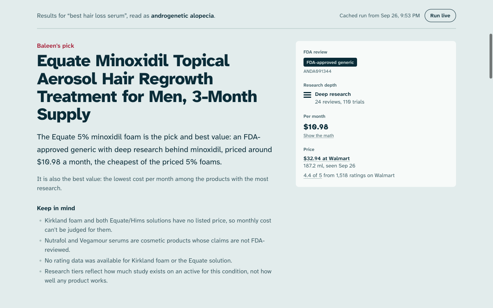

# Baleen

Filters the shelf down to what actually works. A Next.js app that researches skincare and hair loss products live, then ranks them in code on FDA status, research depth and cost per month.

- Live: https://baleen-taupe.vercel.app
- Built solo at OwlHacks 2026 (theme: aquatic), with Claude Code

Asking a chatbot "what's the best hair loss serum" gets a confident answer with no way to check it. Is the store brand the same drug? Is there real research behind it? What does it cost per month? Baleen answers those with sources you can click.

Baleen whales filter krill out of seawater. Baleen does the same for the skincare and hair loss aisle. Ask for "the best hair loss serum" and it researches the question live, then shows its work:

- which products people actually compare, brand name and store brand
- whether two products are the same drug at a different price
- what the FDA label says, and the side effects it warns about
- how much published research exists on each active ingredient
- what each product costs per month, with the math
- a pick, ranked in code, with a short written verdict



## How it works

One request runs a 6-step pipeline. `POST /api/compare` streams each step to the page as NDJSON, so you watch it work.

1. **Search the shelf.** Claude uses web search (5 searches max) to find 6 to 8 products sold in the US. It pulls the brand, actives and strength, package size, label directions, price, retailer and rating. Any URL not in the search results is set to null.
2. **Check the prices.** Code opens every price page. A dead page (404) drops the price. So does a page that names the brand but shows a different price. On a list page, the price has to sit right after the brand name. If a price has the wrong URL but another page from the same store shows it, the price moves to that page.
3. **Check FDA records.** Code looks up each drug product in the openFDA label database. A label only counts if its active ingredient and strength match. It also has to be the same product, not a sibling from the same brand. The label's application number gives the badge: NDA (FDA-approved brand), ANDA (FDA-approved generic) or OTC monograph. Up to 4 side-effect warnings are quoted word for word.
4. **Read the research.** Code counts systematic reviews and randomized trials in Europe PMC for each active and condition. Reviews must name the active in the title. The count sets a depth tier: deep, some, thin or none. That is how much research exists, not how well a product works.
5. **Do the math.** Cost per month = price / months per package. It uses the stated month supply when the package gives one, otherwise the label's daily amount. Anything missing means no number. It never guesses. Products with the same active, strength and form form a "same drug" group, compared like for like.
6. **Rank and write the verdict.** Code ranks the products: research depth first, then FDA review, then cost per month. Ties go to an approved application over a monograph drug, then to more studies. Claude writes the summary from the computed facts only, with no tools. Code then drops any sentence that uses a dollar amount not in the data, states rank numbers, or makes claims the rules ban ("effective", "highest", "shallower research").

Web content is treated as data. The prompts tell Claude never to follow instructions found in search results.

### Demo cache

The three example chips (Hair loss, Acne, Anti-aging) serve saved runs from `data/cache/`. The page shows "Cached run from ..." and a "Run live" button. A live run that fails falls back to the saved run and says so.

The saved runs come from live runs on Sep 26, 2026. After the final code fixes that night, everything after the product search (price checks, FDA matches, research counts, cost, ranking) was re-derived from the saved search data. The verdict text was regenerated with the same prompt, schema and code checks, through the Claude Code CLI, because the API key had run out of credits.

## Run it locally

Needs Node 24.

```bash
npm install
cp .env.example .env.local   # then add your ANTHROPIC_API_KEY
npm run dev          # http://localhost:3000
npm test             # 14 node:test tests in lib/pipeline.test.ts, no network
npm run build
npm run warm         # re-run the 3 chip queries live and rewrite data/cache/
```

## Environment variables

| Name | Needed | What it does |
|---|---|---|
| `ANTHROPIC_API_KEY` | For live runs | Claude calls for search and the verdict. Cached chips work without it. |
| `BALEEN_MODEL` | No | Model id. Default `claude-sonnet-5`. |
| `OPENFDA_API_KEY` | No | Raises openFDA's per-IP daily limit. Worth setting on a shared host. |

## Data sources

- [Anthropic web search tool](https://docs.anthropic.com/en/docs/agents-and-tools/tool-use/web-search-tool): product discovery, prices, ratings
- [openFDA drug label API](https://open.fda.gov/apis/drug/label/): application numbers and label warnings
- [DailyMed](https://dailymed.nlm.nih.gov/dailymed/): the full label each FDA badge links to
- [Europe PMC REST API](https://europepmc.org/RestfulWebService): review and trial counts, top citations
- [PubMed](https://pubmed.ncbi.nlm.nih.gov/): citation links

## What Baleen can't tell you

- **Brand-level trials are rare.** Almost every study tests the active ingredient, not a specific bottle. So Baleen ranks on the ingredient's research, the product's FDA status and its cost.
- **Research depth is not effect size.** Many studies can still find a small benefit. A cosmetic ingredient with "some" research may barely work.
- **Prices change.** Each price is one retailer on the date shown. Many products come back with no price at all.
- **Cost per month needs a number on the label.** Acne and anti-aging labels say "a pea-sized amount", so those products get no monthly cost.
- **The verdict is written by a model.** Code checks the numbers and banned claims, but not every word.
- **Not medical advice.** Ask a doctor or pharmacist before you start a treatment.
- **Weak rate limit.** Live runs are capped at 6 per IP per hour, in memory, per server instance. A cold start resets it.
- **Live runs are slow.** About 30 to 45 seconds: up to 5 web searches, then openFDA and Europe PMC lookups per product.

## Stack

Next.js 15 (App Router), React 19, TypeScript, Tailwind CSS 4, Vercel AI SDK 7 with `@ai-sdk/anthropic`, zod. Tests use Node's built-in test runner. Hosted on Vercel.

## AI disclosure

- **Built with Claude Code.** I set the spec, the types contract (`lib/types.ts`) and the data rules. Claude Code wrote the code, tested it against live data, and fixed what code reviews found, all during OwlHacks 2026.
- **Runtime model:** Claude (Anthropic API, `claude-sonnet-5` by default) makes two calls per live run: one with web search to find products, and one with no tools to write the verdict from the computed facts. Everything in between is plain code.
